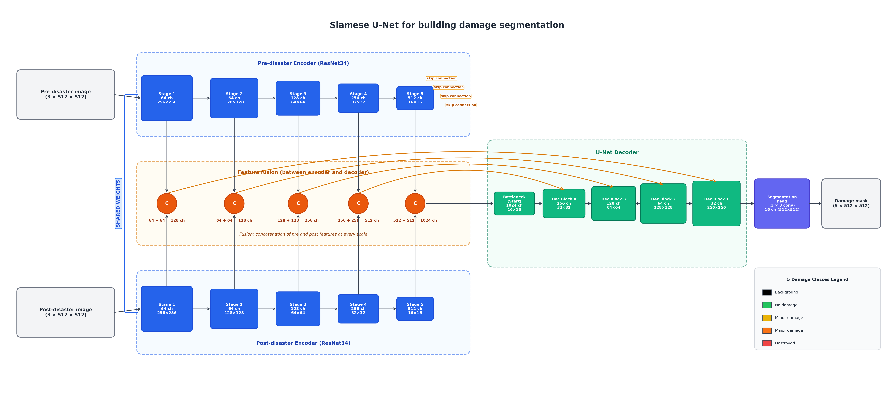

# Model: Siamese U-Net

   

This document describes the architecture of the final model of this project: a **Siamese U-Net** that takes a pre-disaster and a post-disaster satellite image of the same area and outputs a pixel-level building damage mask.

Code: `src/models/siamese_unet.py` (class `SiameseUNet`).

---

## 1. Overview

```
Pre-disaster image  (3 × 512 × 512) ──► ResNet34 encoder ──► 5 feature maps ──┐
                                         (shared weights)                     ├──► concat at each scale ──► U-Net decoder ──► segmentation head ──► damage mask (5 × 512 × 512)
Post-disaster image (3 × 512 × 512) ──► ResNet34 encoder ──► 5 feature maps ──┘
```

The model has three parts:

| Part | What it does |
|---|---|
| **Shared encoder** | Extracts features from the pre and the post image separately, with the **same** network and the **same** weights |
| **Fusion (concatenation)** | Combines the pre and post features **at each of the 5 scales**, between the encoder and the decoder |
| **U-Net decoder + head** | Upsamples the fused features back to the input size and predicts 5 class scores for every pixel |

Input/output sizes are given for a 512 × 512 training crop. Validation and test images are 1024 × 1024; the model is fully convolutional, so all spatial sizes simply double.

---

## 2. Shared encoder

- **Network:** ResNet34, pretrained on ImageNet (He et al., 2016).
- **Siamese:** there is only **one** encoder in the model. It is applied twice: once to the pre-disaster image and once to the post-disaster image. Both images are therefore processed with the same weights ("the same eyes"), so differences between the two feature maps come from the images, not from the network (Daudt et al., 2018).
- The encoder has **5 stages**. Each stage halves the spatial size and outputs a feature map:

| Stage | Channels | Spatial size |
|---|---|---|
| 1 | 64 | 256 × 256 |
| 2 | 64 | 128 × 128 |
| 3 | 128 | 64 × 64 |
| 4 | 256 | 32 × 32 |
| 5 | 512 | 16 × 16 |

Early stages capture fine details (edges, colors); deeper stages capture larger structures (buildings, the scene).

---

## 3. Fusion: where and how the concatenation happens

**Where:** between the encoder and the decoder, **at each of the 5 encoder stages separately**. It is not done at the input (the two images are never stacked into one 6-channel image) and not at the output.

**How:** at each stage, the pre and post feature maps have exactly the same spatial size. They are concatenated along the **channel** dimension. The spatial size does not change; the number of channels doubles. At every pixel, the fused map contains both "what was there before" and "what is there now".

| Stage | Pre | Post | Fused (concatenated) | Spatial size |
|---|---|---|---|---|
| 1 | 64 | 64 | **128** | 256 × 256 |
| 2 | 64 | 64 | **128** | 128 × 128 |
| 3 | 128 | 128 | **256** | 64 × 64 |
| 4 | 256 | 256 | **512** | 32 × 32 |
| 5 | 512 | 512 | **1024** | 16 × 16 |

In code (`SiameseUNet.forward`):
```python
pre_features = self.encoder(pre)
post_features = self.encoder(post)
for i in range(len(pre_features)):
    fused = torch.cat([pre_features[i], post_features[i]], dim=1)   # dim=1: channel dimension
```

This corresponds to the **FC-Siam-conc** design of Daudt et al. (2018): feature-level fusion at multiple scales, as opposed to early fusion (FC-EF, stacking the images at the input).

Note: smp's encoder also returns the input image itself as the first element of the feature list, so the loop concatenates 6 elements; the decoder ignores this first element, so in practice the fusion happens at the 5 encoder stages above.

An alternative fusion, the absolute difference `|post − pre|` (channels unchanged), was also tested (experiment A2) and was slightly worse.

---

## 4. U-Net decoder

The decoder is a standard U-Net decoder (Ronneberger et al., 2015), from the `segmentation-models-pytorch` library. It receives the **fused** feature maps.

- It starts from the deepest fused map (stage 5: 1024 channels, 16 × 16).
- It has **5 upsampling blocks**. Each block doubles the spatial size and applies two 3 × 3 convolutions.
- **Skip connections:** in each of the first 4 blocks, the upsampled features are concatenated with the fused feature map of the same spatial size (stages 4, 3, 2, 1). This is a **second, different concatenation**, inside the decoder: it brings back the fine spatial details lost during downsampling. Every U-Net has it, including the baseline.

| Decoder block | Upsampled to | Skip connection from | Output channels |
|---|---|---|---|
| 1 | 32 × 32 | fused stage 4 (512) | 256 |
| 2 | 64 × 64 | fused stage 3 (256) | 128 |
| 3 | 128 × 128 | fused stage 2 (128) | 64 |
| 4 | 256 × 256 | fused stage 1 (128) | 32 |
| 5 | 512 × 512 | — | 16 |

The decoder channels (256, 128, 64, 32, 16) are the same as in the baseline U-Net, so the only difference between the two models is the use of the pre-disaster image.

---

## 5. Segmentation head and output

- **Head:** a 3 × 3 convolution that maps the 16 decoder channels to **5 class scores** per pixel.
- **Output:** 5 × 512 × 512 (logits). The predicted class of each pixel is the class with the highest score.

| Class | Value |
|---|---|
| Background | 0 |
| No damage | 1 |
| Minor damage | 2 |
| Major damage | 3 |
| Destroyed | 4 |

---

## 6. Size

| Model | Parameters |
|---|---|
| Baseline U-Net (post image only) | 24.4 M |
| **Siamese U-Net (concat)** | **26.4 M** |

The encoder is shared, so its weights are counted once; the extra parameters come from the decoder, which receives twice as many channels.

---

## 7. Training (final model)

| | |
|---|---|
| Loss | 0.5 × Focal loss (γ = 2, class weights) + 0.5 × Dice loss (damage classes only) |
| Epochs | up to 40, early stopping with patience 8 (20% of the maximum) |
| Optimizer | AdamW, learning rate 0.0001, batch size 8, mixed precision |
| Input | random 512 × 512 crops with flips and 90° rotations (identical for pre, post and mask) |
| Config | `configs/siamese_concat_fd40.yaml` |

---

## References

- Daudt, R. C., Le Saux, B., & Boulch, A. (2018). Fully Convolutional Siamese Networks for Change Detection. ICIP.
- He, K., Zhang, X., Ren, S., & Sun, J. (2016). Deep Residual Learning for Image Recognition. CVPR.
- Ronneberger, O., Fischer, P., & Brox, T. (2015). U-Net: Convolutional Networks for Biomedical Image Segmentation. MICCAI.