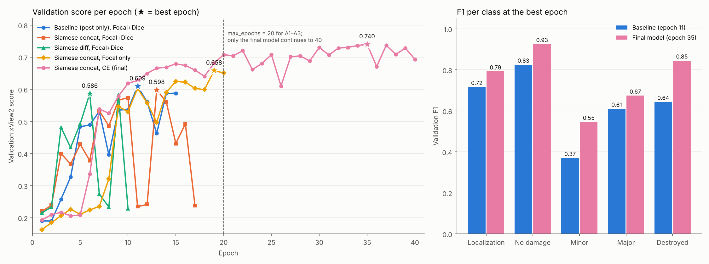

# Results

All scores in this file are computed on the **validation set** unless stated otherwise.
The test set is used only once, for the two final candidates and the baseline (Phase 7, `reports/test_results.md`).

**Metric:** xView2 score = 0.3 × F1_loc + 0.7 × F1_dmg, where F1_dmg is the harmonic mean of the F1 scores of the four damage classes.

**Protocol:** same split, data augmentation, class weights, optimizer (AdamW, learning rate 0.0001) and batch size for all experiments. Early stopping with patience = 20% of `max_epochs`. Experiments 1–5 use `max_epochs` = 20; each changes **one** setting at a time. Each configuration was trained once without a fixed seed, so differences of ~0.01–0.02 are within the epoch-to-epoch fluctuations and are not interpreted.

---

## 1. Experiments (validation set, best epoch)

| # | Experiment | Input | Fusion | Loss | Best epoch / stopped | Val score | F1_loc | F1_dmg | Config |
|---|---|---|---|---|---|---|---|---|---|
| 1 | Baseline U-Net | Post only | – | Focal + Dice (λ = 0.5) | 11 / 15 | 0.6095 | 0.717 | 0.563 | `configs/baseline.yaml` |
| 2 | Siamese U-Net | Pre + post | Concat | Focal + Dice (λ = 0.5) | 13 / 17 | 0.5981 | 0.787 | 0.517 | `configs/siamese_concat.yaml` |
| 3 | Siamese U-Net | Pre + post | Diff | Focal + Dice (λ = 0.5) | 6 / 10 | 0.5865 | 0.791 | 0.499 | `configs/siamese_diff.yaml` |
| 4 | Siamese U-Net | Pre + post | Concat | Focal only (λ = 1) | 19 / 20 | 0.6583 | 0.790 | 0.602 | `configs/siamese_focal.yaml` |
| 5 | Siamese U-Net | Pre + post | Concat | Class-weighted CE (γ = 0, λ = 1) | 20 / 20 | 0.7079 | 0.788 | 0.673 | `configs/siamese_ce.yaml` |
| **6** | **CE, 40 epochs** (#5 continued) | Pre + post | Concat | Class-weighted CE | **35 / 40** | **0.7401** | 0.793 | **0.718** | `configs/siamese_ce_long.yaml` |
| **7** | **Focal + Dice, 40 epochs** (advisor's configuration) | Pre + post | Concat | Focal + Dice (λ = 0.5) | 12 / 20 | 0.6285 | **0.801** | 0.555 | `configs/siamese_concat_fd40.yaml` |

## 2. Per-class F1 (validation set, best epoch)

| # | Experiment | No damage | Minor | Major | Destroyed |
|---|---|---|---|---|---|
| 1 | Baseline (Focal + Dice) | 0.826 | 0.371 | 0.611 | 0.644 |
| 2 | Siamese concat (Focal + Dice) | 0.849 | 0.280 | 0.603 | 0.753 |
| 3 | Siamese diff (Focal + Dice) | 0.862 | 0.267 | 0.568 | 0.743 |
| 4 | Siamese concat (Focal only) | 0.899 | 0.365 | 0.637 | 0.819 |
| 5 | Siamese concat (CE, 20 epochs) | 0.908 | 0.463 | 0.666 | 0.850 |
| **6** | **Siamese concat (CE, 40 epochs)** | **0.926** | **0.547** | **0.675** | 0.846 |
| **7** | **Siamese concat (Focal + Dice, 40 epochs)** | 0.806 | 0.341 | 0.593 | 0.742 |

---

## 3. Ablation findings

### A2 — Fusion: concat vs. difference (#2 vs. #3)

Concatenation is slightly better (0.598 vs. 0.587); the difference is small. Difference fusion does not hurt localization (0.791), contrary to our concern that unchanged buildings would become invisible. Concat is kept for the following experiments.

### A3 — Loss function (#2 vs. #4 vs. #5)

**CE > Focal only > Focal + Dice.** Removing the Dice loss improves the score by +0.06; removing the focal term (γ = 2 → 0) improves it by another +0.05.

- **The Dice loss destabilizes the destroyed class.** With Focal + Dice, the destroyed F1 drops to ~0 in several epochs in both Siamese models (concat: epochs 11, 12, 17; diff: 7, 8, 10) while the localization F1 stays high, i.e. destroyed buildings are still found but assigned to another class. These collapses fill the patience counter and stop training early. Without Dice (#4, #5), the destroyed F1 never collapses. A likely cause: Dice is computed per class on each 512×512 crop, and penalizes the model even for classes that are absent from the crop.
- **The focal term slows down learning.** With focal only, minor damage is almost not learned during the first 8 epochs (F1 ≤ 0.01); with CE it starts at epoch 6. Since class weights already compensate for the imbalance, down-weighting easy pixels further weakens the training signal.

### A1 — Pre-disaster image: baseline vs. Siamese (#1 vs. #2, #5, #6)

- With Focal + Dice, the Siamese model is better at localization (+0.07) and destroyed (+0.11) but worse at minor damage (−0.09), so the overall score is similar (0.598 vs. 0.610).
- With class-weighted CE, the Siamese model is better than the baseline for **every** class (#5: +0.10 overall). The loss function was hiding the benefit of the pre-disaster image.
- Note: the baseline was not trained with CE, so the comparison #1 vs. #5/#6 changes two settings at once.

### CE, 40 epochs (#6)

The CE model was still improving at epoch 20, so training was **resumed from its 20-epoch checkpoint** (`last.pt`) up to 40 epochs (patience 8). New best scores at epochs 22, 30, 33, 34 and 35; best **0.7401** at epoch 35 (mean of the 3 best epochs: 0.738). The gain over 20 epochs (+0.032) comes mostly from minor damage (0.463 → 0.547). The A3 comparison remains fair, since all its experiments use 20 epochs.

Compared to the baseline: **+0.131** overall; no damage +0.10, minor +0.18, major +0.06, destroyed +0.20, localization +0.08.

### Focal + Dice, 40 epochs (#7, advisor's configuration)

At the advisor's request, the Siamese concat model was trained with **Focal + Dice** and `max_epochs` = 40 (patience 8), from scratch. It is experiment #2 with a longer training budget.

- Best **0.6285 at epoch 12**; early stopping at epoch 20, so the extra epochs were not used.
- Highest localization F1 of all experiments (0.801), but a low damage F1 (0.555), mainly because of minor damage (0.341).
- The destroyed class collapsed again (F1 0.036 at epoch 10, 0.001 at epoch 13), as in #2 and #3. These collapses fill the patience counter and stop training early.
- Compared to #2 (20 epochs): +0.03, within the run-to-run variation. A longer budget does not help Focal + Dice, because training stops long before it is reached.

Both #6 and #7 were fixed as final candidates **before** the test evaluation, and both were evaluated on the test set (Phase 7):

| | Val score | **Test score** |
|---|---|---|
| Baseline (#1) | 0.6095 | 0.6152 |
| Siamese, Focal + Dice, 40 epochs (#7) | 0.6285 | 0.6134 |
| **Siamese, CE, 40 epochs (#6)** | **0.7401** | **0.7198** |

Details: `reports/test_results.md`.

---

## 4. Experiment details

### 1. Baseline U-Net (Phase 5)

- **Model:** U-Net with a ResNet34 encoder (ImageNet weights), using only the post-disaster image
- **Training:** random 512×512 crops with flips and 90° rotations, batch size 8, AdamW (learning rate 0.0001), AMP
- **Loss:** 0.5 × Focal (γ = 2, smoothed inverse-frequency class weights) + 0.5 × Dice (damage classes only)
- **Validation:** full 1024×1024 images
- **Early stopping:** `max_epochs` = 20, patience = 4; stopped at epoch 15, best epoch 11
- **Training time:** 2.2 hours on a Kaggle T4 GPU (~9 min per epoch)
- **Notebook:** `notebooks/05_train_baseline.ipynb` · **Log:** `reports/logs/baseline_log.csv` · **Curves:** `reports/figures/baseline_curves.png`

### 2–5. Siamese U-Net experiments (Phase 6)

- **Model:** Siamese U-Net — one ResNet34 encoder (ImageNet weights) shared by the pre- and post-disaster images, fusion of the two feature maps at each of the 5 scales (concatenation or absolute difference), U-Net decoder. 26.4M parameters (concat), 24.4M (diff).
- **Training:** same as the baseline. `max_epochs` = 20, patience = 4.
- **Training time:** ~9–11 min per epoch, the same as the baseline: training is limited by data loading, not by the GPU (the encoder runs twice).
- **Notebook:** `notebooks/06_train_siamese.ipynb`
- **Logs:** `reports/logs/siamese_concat_log.csv`, `siamese_diff_log.csv`, `siamese_focal_log.csv`, `siamese_ce_log.csv`

### 6. CE, 40 epochs (Phase 6)

- Experiment #5 resumed from its epoch-20 checkpoint with `max_epochs` = 40 (patience 8); 3.7 additional hours.
- **Notebook:** `notebooks/06b_train_ce_long.ipynb` · **Log:** `reports/logs/siamese_ce_long_log.csv` (epochs 1–40)
- **Weights:** `best.pt` (epoch 35), stored in the output of the Kaggle notebook (version 3; the notebook was later renamed `06c_train_siamese_fd40` on Kaggle).

### 7. Focal + Dice, 40 epochs (Phase 6, advisor's request)

- Experiment #2 trained from scratch with `max_epochs` = 40 (patience 8); stopped at epoch 20.
- **Notebook:** `notebooks/06c_train_siamese_fd.ipynb` · **Log:** `reports/logs/siamese_concat_fd40_log.csv`

---

## 5. Limitations of the comparisons

- Each configuration was trained once without a fixed seed; only large differences are interpreted.
- The validation score fluctuates strongly between epochs, mainly because the damage F1 is a harmonic mean dominated by the weakest class.
- The CE model (#6) reached `max_epochs` (40) with no improvement after epoch 35 but without triggering early stopping, so slightly longer training might still help.
- Experiment #6 continues #5 from a checkpoint, while #7 was trained from scratch; both had a budget of 40 epochs.
- All scores above are on the validation set, which was used for model selection; the unbiased estimates are the test scores (Phase 7).