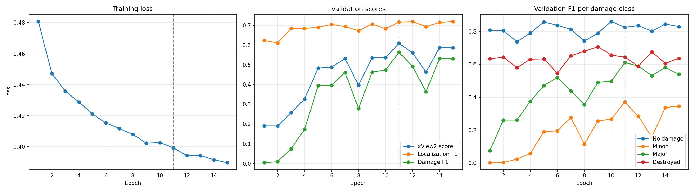

# Results

All scores in this file are computed on the **validation set**.
The test set is used only once, for the final model (Phase 7).

**Metric:** xView2 score = 0.3 × F1_loc + 0.7 × F1_dmg, where F1_dmg is the harmonic mean of the F1 scores of the four damage classes.

---

## 1. Experiments (validation set)

| # | Experiment | Input | Loss | Best epoch | Val score | F1_loc | F1_dmg | Config |
|---|---|---|---|---|---|---|---|---|
| 1 | Baseline U-Net (ResNet34) | Post only | Focal + Dice (λ = 0.5) | 11 / 15 | **0.6095** | 0.717 | 0.563 | `configs/baseline.yaml` |

## 2. Per-class F1 (validation set, best epoch)

| # | Experiment | No damage | Minor | Major | Destroyed |
|---|---|---|---|---|---|
| 1 | Baseline U-Net (ResNet34) | 0.826 | 0.371 | 0.611 | 0.644 |

---

## 3. Experiment details

### 1. Baseline U-Net (Phase 5)

- **Model:** U-Net with a ResNet34 encoder (ImageNet weights), using only the post-disaster image
- **Training:** random 512×512 crops with flips and 90° rotations, batch size 8, AdamW (learning rate 0.0001), AMP
- **Loss:** 0.5 × Focal (γ = 2, smoothed inverse-frequency class weights) + 0.5 × Dice (damage classes only)
- **Validation:** full 1024×1024 images
- **Early stopping:** `max_epochs` = 20, patience = 4 (20% of `max_epochs`); stopped at epoch 15, best epoch 11
- **Training time:** 2.2 hours on a Kaggle T4 GPU
- **Notebook:** `notebooks/05_train_baseline.ipynb`
- **Training log:** `reports/logs/baseline_log.csv`
- **Training curves:** `reports/figures/baseline_curves.png`

**Observations:**
- Minor damage is the hardest class (F1 0.371).
- The validation score *fluctuates* strongly between epochs. The fluctuations come from the minor-damage F1, which dominates the harmonic mean of the damage F1.
- No-damage and destroyed are recognized from the first epochs, major and minor damage are learned more slowly.

