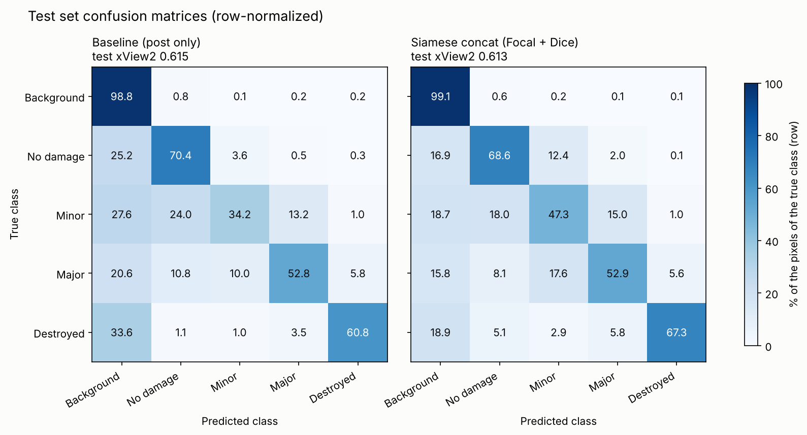

# Test Results

Final evaluation on the **test set** (2,207 image pairs, `splits/test.csv`), which was never used for training or model selection.

**Protocol**
- Each model is evaluated **once** on the test set; nothing is changed afterwards.
- Before the test run, each loaded checkpoint was evaluated on the validation set and gave exactly the validation score logged during training (sanity check).
- Two final candidates were fixed **before** looking at the test set: the Siamese U-Net trained with **Focal + Dice** (the configuration requested by the advisor) and the Siamese U-Net trained with **class-weighted cross-entropy** (the best configuration of our ablations). Both are reported; neither is chosen based on its test score.
- Code: `src/evaluate.py` · Notebook: `notebooks/07a_evaluate_fd.ipynb` · Raw results: `reports/test_results_fd.json`

**Metric:** xView2 score = 0.3 × F1_loc + 0.7 × F1_dmg (F1_dmg = harmonic mean of the four damage-class F1 scores). All pixel counts are accumulated over the whole test set before computing F1.

---

## 1. Overall results

| Model | Loss | Val score | **Test score** | Test F1_loc | Test F1_dmg |
|---|---|---|---|---|---|
| Baseline U-Net (post image only) | Focal + Dice | 0.6095 | **0.6152** | 0.7070 | **0.5759** |
| Siamese U-Net, concat (40 epochs) | Focal + Dice | 0.6285 | **0.6134** | **0.7930** | 0.5364 |
| Siamese U-Net, concat (40 epochs) | Class-weighted CE | 0.7401 | *pending* | | |

- The test scores are close to the validation scores (−0.015 for the Siamese model, +0.006 for the baseline): no sign of overfitting to the validation set.
- With Focal + Dice, **the two models have the same overall test score** (difference 0.002, well within the run-to-run variation).

## 2. Per-class F1 (test set)

| Model | Localization | No damage | Minor | Major | Destroyed |
|---|---|---|---|---|---|
| Baseline (Focal + Dice) | 0.707 | **0.809** | **0.377** | **0.614** | 0.699 |
| Siamese concat (Focal + Dice) | **0.793** | 0.799 | 0.323 | 0.559 | **0.757** |

The Siamese model is clearly better at **localization (+0.086)** and **destroyed (+0.058)**, and worse at minor (−0.054) and major (−0.055). Because the damage F1 is a harmonic mean, the weaker minor and major scores cancel the gains: the same pattern as on the validation set (Phase 6, experiment A1).

## 3. Confusion matrices (test set, row-normalized)

Each row shows how the pixels of one true class were predicted (in % of that class).

| True class | Correct: baseline | Correct: Siamese | Predicted as background: baseline → Siamese |
|---|---|---|---|
| No damage | 70.4% | 68.6% | 25.2% → **16.9%** |
| Minor | 34.2% | **47.3%** | 27.6% → **18.7%** |
| Major | 52.8% | 52.9% | 20.6% → 15.8% |
| Destroyed | 60.8% | **67.3%** | 33.6% → **18.9%** |

**Findings**
- **The pre-disaster image helps to find damaged buildings.** The baseline misses a third of the destroyed pixels (33.6% predicted as background), since a destroyed building often no longer looks like a building in the post image. The Siamese model sees the intact building in the pre image and misses far fewer (18.9%). This is the source of its higher localization F1.
- **Minor damage: higher recall, lower precision.** The Siamese model finds more minor damage (47.3% vs. 34.2%), but also labels many undamaged pixels as minor (no damage → minor: 3.6% → 12.4%). Since undamaged buildings are ~10 times more frequent, these false alarms lower the minor-damage precision and F1. Small differences between the pre and post images (lighting, viewing angle, season) may look like slight damage.
- **Minor and major are confused with each other** in both models (minor → major ~13–15%, major → minor 10–18%), as expected for neighboring levels of an ordinal scale.
- 5.6–5.8% of the destroyed pixels are predicted as major in both models; on the validation set, the Focal + Dice Siamese models occasionally assigned almost all destroyed buildings to another class (destroyed collapse, Phase 6).

## 4. Results per disaster type (test set)

| Disaster type | Baseline score | Siamese score | Baseline F1_loc | Siamese F1_loc |
|---|---|---|---|---|
| Wind | 0.535 | **0.548** | 0.721 | **0.798** |
| Flooding | 0.233 | **0.358** | 0.691 | **0.804** |
| Fire | 0.274 | **0.312** | 0.709 | **0.772** |
| Tsunami | 0.211 | **0.241** | 0.703 | **0.804** |
| Earthquake | 0.215 | **0.237** | 0.715 | **0.791** |
| Volcano | 0.183 | **0.328** | 0.611 | **0.732** |

- **The Siamese model is better in every disaster type**, and its localization F1 is higher by 0.06–0.12 everywhere, although the two models have the same overall score. The overall score pools the pixels of all events before computing the harmonic mean, so it is not an average of the per-type scores; looking only at the overall score hides this consistent advantage.
- The per-type scores are much lower than the overall score because several damage classes are almost absent within a single disaster type (e.g. destroyed in earthquake, minor in tsunami), which pulls the harmonic mean towards 0. Per-type results should therefore be read through the localization F1 and the per-class F1 scores (`test_results_fd.json`).
- **Earthquake:** damage F1 = 0 for both models, as expected from the EDA (the only earthquake event, Mexico City, has almost no damaged buildings). Only localization and no-damage are meaningful there (Siamese: no damage F1 0.913).
- **Wind** is the only type with a reasonable damage F1 (~0.44–0.46), because it is the only type in which all four damage classes are well represented.

## 5. Siamese U-Net with class-weighted CE

*To be added after the evaluation in `notebooks/07b_evaluate_ce.ipynb`.*