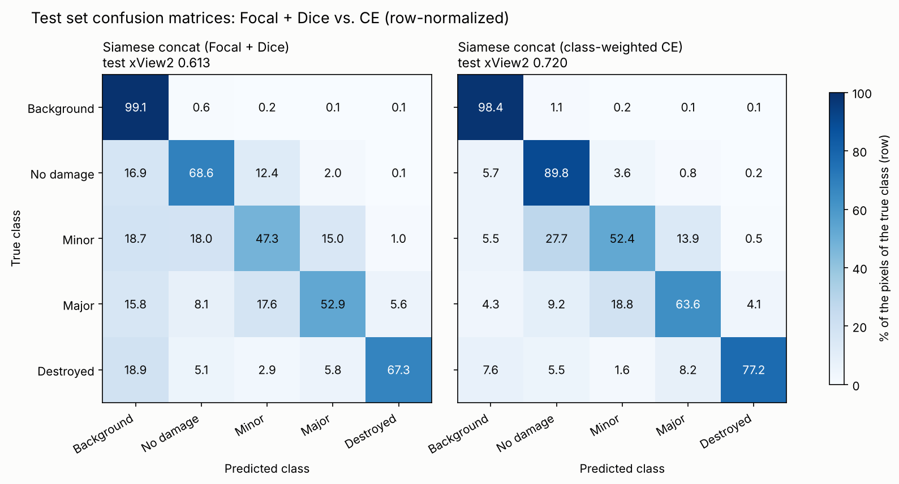

# Test Results

Final evaluation on the **test set** (2,207 image pairs, `splits/test.csv`), which was never used for training or model selection.

**Protocol**
- Each model is evaluated **once** on the test set; nothing is changed afterwards.
- Before the test run, each loaded checkpoint was evaluated on the validation set and gave exactly the validation score logged during training (sanity check).
- Two final candidates were fixed **before** looking at the test set: the Siamese U-Net trained with **Focal + Dice** (the configuration requested by the advisor) and the Siamese U-Net trained with **class-weighted cross-entropy** (the best configuration of our ablations). Both are reported; neither is chosen based on its test score.
- Code: `src/evaluate.py` · Notebooks: `notebooks/07a_evaluate_fd.ipynb` (Focal + Dice, baseline), `notebooks/07b_evaluate_ce.ipynb` (CE) · Raw results: `reports/test_results_fd.json`, `reports/test_results_ce.json`

**Metric:** xView2 score = 0.3 × F1_loc + 0.7 × F1_dmg (F1_dmg = harmonic mean of the four damage-class F1 scores). All pixel counts are accumulated over the whole test set before computing F1.

---

## 1. Overall results

| Model | Loss | Val score | **Test score** | Test F1_loc | Test F1_dmg |
|---|---|---|---|---|---|
| Baseline U-Net (post image only) | Focal + Dice | 0.6095 | **0.6152** | 0.7070 | **0.5759** |
| Siamese U-Net, concat (40 epochs) | Focal + Dice | 0.6285 | **0.6134** | **0.7930** | 0.5364 |
| Siamese U-Net, concat (40 epochs) | Class-weighted CE | 0.7401 | **0.7198** | 0.7841 | **0.6922** |

- The test scores are close to the validation scores (−0.015 and −0.020 for the Siamese models, +0.006 for the baseline): no sign of strong overfitting to the validation set.
- With Focal + Dice, **the baseline and the Siamese model have the same overall test score** (difference 0.002, well within the run-to-run variation).
- **The Siamese model trained with class-weighted CE has the best test score (0.720)**, about +0.105 above both Focal + Dice models. The gain comes almost entirely from the damage F1 (+0.156); the localization F1 is about the same (see Section 5).

## 2. Per-class F1 (test set)

| Model | Localization | No damage | Minor | Major | Destroyed |
|---|---|---|---|---|---|
| Baseline (Focal + Dice) | 0.707 | **0.809** | **0.377** | **0.614** | 0.699 |
| Siamese concat (Focal + Dice) | **0.793** | 0.799 | 0.323 | 0.559 | 0.757 |
| Siamese concat (CE) | 0.784 | **0.926** | **0.499** | **0.670** | **0.831** |

With Focal + Dice, the Siamese model is clearly better than the baseline at **localization (+0.086)** and **destroyed (+0.058)**, and worse at minor (−0.054) and major (−0.055). Because the damage F1 is a harmonic mean, the weaker minor and major scores cancel the gains: the same pattern as on the validation set (Phase 6, experiment A1).

The CE model is the best in all four damage classes, by +0.07 to +0.18 over the Focal + Dice Siamese model.

## 3. Confusion matrices (test set, row-normalized)

Each row shows how the pixels of one true class were predicted (in % of that class).

| True class | Correct: baseline | Correct: Siamese | Predicted as background: baseline → Siamese |
|---|---|---|---|
| No damage | 70.4% | 68.6% | 25.2% → **16.9%** |
| Minor | 34.2% | **47.3%** | 27.6% → **18.7%** |
| Major | 52.8% | 52.9% | 20.6% → 15.8% |
| Destroyed | 60.8% | **67.3%** | 33.6% → **18.9%** |

**Findings**
- **The pre-disaster image helps to find damaged buildings.** The baseline misses a third of the destroyed pixels (33.6% predicted as background), since a destroyed building often no longer looks like a building in the post image. The Siamese model sees the intact building in the pre image and misses far fewer (18.9%). This is the source of its higher localization F1.
- **Minor damage: higher recall, lower precision.** The Siamese model finds more minor damage (47.3% vs. 34.2%), but also labels many undamaged pixels as minor (no damage → minor: 3.6% → 12.4%). Since undamaged buildings are ~10 times more frequent, these false alarms lower the minor-damage precision and F1. Small differences between the pre and post images (lighting, viewing angle, season) may look like slight damage.
- **Minor and major are confused with each other** in both models (minor → major ~13–15%, major → minor 10–18%), as expected for neighboring levels of an ordinal scale.
- 5.6–5.8% of the destroyed pixels are predicted as major in both models; on the validation set, the Focal + Dice Siamese models occasionally assigned almost all destroyed buildings to another class (destroyed collapse, Phase 6).

## 4. Results per disaster type (test set)

| Disaster type | Baseline score | Siamese FD score | Siamese CE score | Baseline F1_loc | Siamese FD F1_loc | Siamese CE F1_loc |
|---|---|---|---|---|---|---|
| Wind | 0.535 | 0.548 | **0.682** | 0.721 | **0.798** | 0.776 |
| Flooding | 0.233 | 0.358 | **0.446** | 0.691 | **0.804** | 0.799 |
| Fire | 0.274 | 0.312 | **0.328** | 0.709 | **0.772** | 0.763 |
| Tsunami | 0.211 | 0.241 | **0.244** | 0.703 | 0.804 | **0.814** |
| Earthquake | 0.215 | **0.237** | 0.236 | 0.715 | **0.791** | 0.787 |
| Volcano | 0.183 | **0.328** | 0.246 | 0.611 | **0.732** | 0.728 |

FD = Focal + Dice.

- **Both Siamese models are better than the baseline in every disaster type**, and its localization F1 is higher by 0.06–0.12 everywhere, although the two models have the same overall score. The overall score pools the pixels of all events before computing the harmonic mean, so it is not an average of the per-type scores; looking only at the overall score hides this consistent advantage.
- The per-type scores are much lower than the overall score because several damage classes are almost absent within a single disaster type (e.g. destroyed in earthquake, minor in tsunami), which pulls the harmonic mean towards 0. Per-type results should therefore be read through the localization F1 and the per-class F1 scores (`test_results_fd.json`).
- **Earthquake:** damage F1 = 0 for both models, as expected from the EDA (the only earthquake event, Mexico City, has almost no damaged buildings). Only localization and no-damage are meaningful there (Siamese: no damage F1 0.913).
- **Wind** is the only type with a reasonable damage F1 (~0.44–0.46 with Focal + Dice, 0.64 with CE), because it is the only type in which all four damage classes are well represented.
- The CE model gains most in **wind (+0.13)** and **flooding (+0.09)**, the two types where minor and major damage occur. It is worse than the Focal + Dice model only in **volcano**, the smallest type (about 1% of the buildings), where its minor and major F1 are close to 0.

## 5. Siamese U-Net: Focal + Dice vs. class-weighted CE

Same architecture (Siamese U-Net, concat), same data and same training settings; **only the loss differs.**

| | Focal + Dice | CE |
|---|---|---|
| Epochs (max 40) | best epoch 12, stopped at 20 | best epoch 35, ran all 40 |
| Val score | 0.6285 | 0.7401 |
| **Test score** | 0.6134 | **0.7198** |
| Test F1_loc | **0.793** | 0.784 |
| Test F1_dmg | 0.536 | **0.692** |

| True class | Correct: Focal + Dice | Correct: CE | Predicted as background: Focal + Dice → CE |
|---|---|---|---|
| No damage | 68.6% | **89.8%** | 16.9% → **5.7%** |
| Minor | 47.3% | **52.4%** | 18.7% → **5.5%** |
| Major | 52.9% | **63.6%** | 15.8% → **4.3%** |
| Destroyed | 67.3% | **77.2%** | 18.9% → **7.6%** |

**Findings**
- **CE misses far fewer building pixels.** With Focal + Dice, 16–19% of the pixels of every building class are predicted as background; with CE only 4–8%. The CE model also predicts slightly more background as building (1.1% vs. 0.6% of the background, predicted as no damage), so its localization F1 is about the same (0.784 vs. 0.793), but its damage classes recover much more of each building.
- **No false minor alarms.** The Focal + Dice model labelled 12.4% of the undamaged pixels as minor; the CE model only 3.6%. This raises the no-damage F1 from 0.80 to 0.93 and the minor precision from 17.8% to 27.7%.
- **Minor is still the hardest class.** 27.7% of the minor pixels are predicted as no damage and 13.9% as major. Minor damage is subtle and close to its neighbours on the ordinal scale.
- **No destroyed collapse.** The CE training never showed the sudden drops of the destroyed F1 seen with Dice (Phase 6); on the test set, destroyed has the second best F1 (0.831).
- Likely reasons: the γ = 2 focusing term of the Focal loss lowers the weight of pixels that are already classified well, which slows learning of the large building regions; the Dice term, computed over very few pixels of the rare classes, gives unstable gradients (destroyed collapses). CE with class weights gives a stable signal for all pixels, so the model kept improving until epoch 35.

**Conclusion.** The architecture is the same, so the gap (+0.106 test score) is caused by the loss function. **The Siamese U-Net trained with class-weighted cross-entropy is the best model of this project on the test set.** Both models were fixed before the test evaluation and are reported together; this comparison is a single run per configuration without a fixed seed, but the gap is about 50 times larger than the difference between the two Focal + Dice models (0.002).