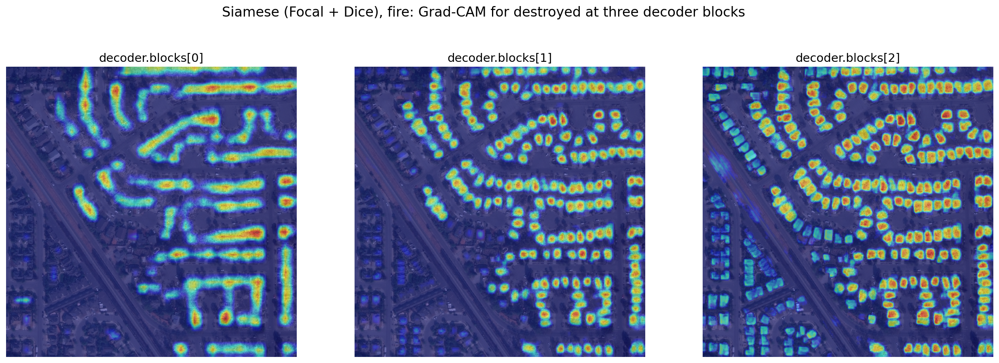
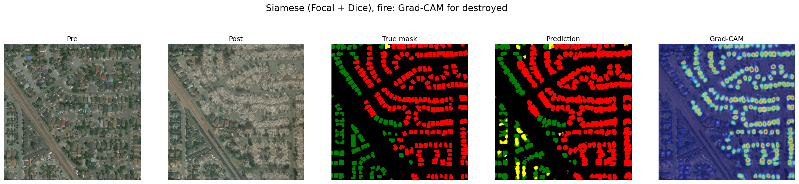
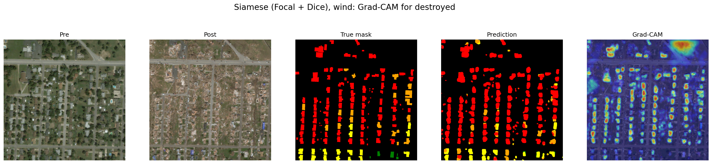
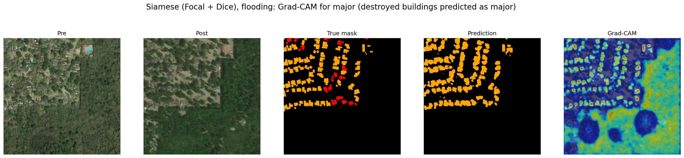
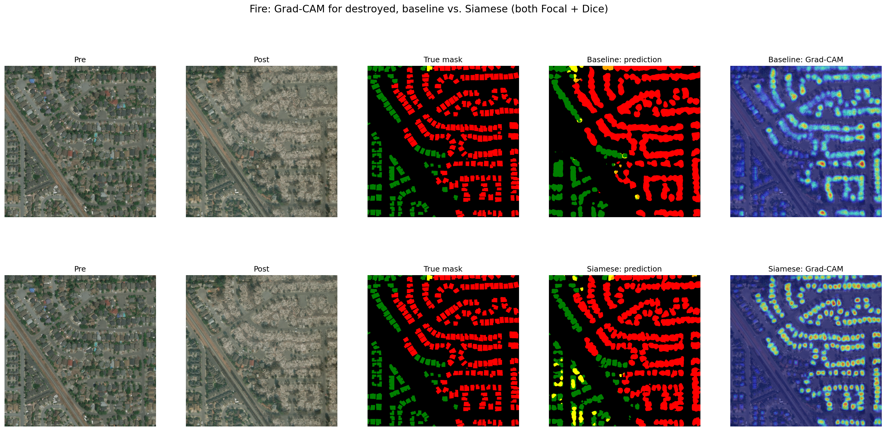
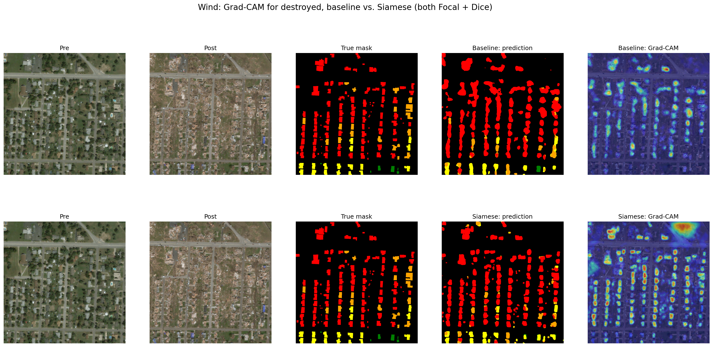

# Explainability (XAI): Grad-CAM

**Question:** When the model predicts a damage class, which part of the image does it look at: the damaged building itself, or the disaster context around it (flood water, burn scars, debris)?

**Model analysed:** the Siamese U-Net (concat) trained with **Focal + Dice**, 40 epochs (the configuration requested by the advisor; test xView2 score 0.613). The baseline U-Net (post image only, Focal + Dice) is used for comparison.

**Data:** test set (`splits/test.csv`). Grad-CAM does not change the models, so using test images does not affect the test results of Phase 7.

Code: `src/xai/gradcam.py`, `src/xai/plots.py` · Notebook: `notebooks/08_gradcam.ipynb` · Raw results: `reports/xai_results.json` · Literature: `docs/literature.md`, Section E

---

## 1. Method

### 1.1 Grad-CAM

Grad-CAM (Selvaraju et al., 2017) explains one score of the model with a heat map:
1. The gradients of the score with respect to the feature maps of one layer are computed.
2. The gradients are averaged per channel; this average is the importance of the channel.
3. The feature maps are summed with these weights and passed through a ReLU (only regions that **increase** the score are kept).
4. The map is upsampled to the image size and scaled to 0–1.

### 1.2 Target for segmentation (Seg-Grad-CAM)

A segmentation model has one score per pixel and class, not one score per image. Following Vinogradova et al. (2020), the explained score is:

> the sum of the logits of class *c* over all pixels that the model **predicts** as *c*

In words: *"For the pixels you labelled as c, which regions of the image made you say c?"* (`make_target` in `src/xai/gradcam.py`).

If the model predicts class *c* nowhere in the image, this sum is 0 and the map is empty. Only images in which the class is predicted on at least 1,000 pixels are therefore analysed.

### 1.3 Two inputs

The Grad-CAM library (`pytorch-grad-cam`) calls the model with a single input tensor. `SiameseWrapper` takes a 6-channel tensor (pre + post), splits it into the pre and post images and calls the model as usual. The output is identical to `model(pre, post)` (checked with `torch.equal`). The same wrapper is used for the baseline, which ignores the pre image.

### 1.4 Layer

- **Not the encoder:** the encoder is shared and runs twice (once on the pre image, once on the post image), so it never sees both images together, and Grad-CAM cannot tell the two passes apart.
- **Decoder:** it runs once, on the fused pre/post features. Three decoder blocks were compared (Figure 1).

*Figure 1: Grad-CAM for destroyed at three decoder blocks (fire, test image 1617).*

| Block | Resolution (1024 × 1024 input) | Observation |
|---|---|---|
| `decoder.blocks[0]` | 64 × 64 | Coarse: rows of buildings, single buildings not separated |
| `decoder.blocks[1]` | 128 × 128 | One spot per building |
| `decoder.blocks[2]` | 256 × 256 | Sharp building shapes, but also some undamaged buildings; close to a copy of the prediction |

In all three blocks the attention is on the buildings, not on roads or open ground, so the conclusion does not depend on the layer. **`decoder.blocks[1]`** is used for all further results, as a balance between resolution and context. For the baseline, the same block of its decoder is used.

---

## 2. Examples

Template: pre image | post image | true mask | prediction | Grad-CAM on the post image. Mask colours: black = background, green = no damage, yellow = minor, orange = major, red = destroyed. Grad-CAM colours: red = strongest influence on the score, blue = no influence.

### 2.1 Fire, destroyed (correct prediction)

*Figure 2: test image 1617 (fire).*

The prediction matches the true mask closely. The heat lies on the individual burned buildings; roads, open ground and the undamaged buildings in the lower left stay blue. **80.4%** of the heat lies on buildings, which cover 27.5% of the image.

### 2.2 Wind, destroyed (correct prediction)

*Figure 3: test image 436 (wind).*

Most destroyed buildings are found. The heat lies mainly on the buildings, with one strong spot in the top-right corner outside the buildings.

### 2.3 Flooding: destroyed buildings predicted as major (wrong prediction)

*Figure 4: test image 142 (hurricane Harvey, flooding), Grad-CAM for major.*

The model finds all buildings, but predicts **major** for 87.6% of the destroyed pixels (17,952 of 20,487); none is predicted as destroyed. In the Grad-CAM for major, a large area **without buildings** (lower right) is moderately activated, while the surroundings of the buildings are blue. Only **16.9%** of the heat lies on buildings (11.3% of the image).

This pattern is not limited to this image: among the 10 test images with the most destroyed pixels in the first 300 test pairs, the model predicted destroyed correctly on **0 pixels in all 7 hurricane-Harvey images**. Destroyed buildings are rare in flooding events (1,596 of 425,368 buildings, EDA), and major damage comes mostly from flooding (68%), so the model may associate the flooding scene with major damage. Section 3 tests whether this holds in general.

---

## 3. Shortcut check: does the model look at the buildings?

Two examples are not enough to conclude anything (Figures 2 and 4 point in opposite directions). The following measure was therefore computed on 100 test images.

### 3.1 Measure

For each image and class, with the true building mask (all damage classes, un-classified excluded):
- **Heat on buildings** = sum of the Grad-CAM values on building pixels / sum of all Grad-CAM values
- **Building area** = share of building pixels in the image

If the heat were spread randomly over the image, the heat on buildings would equal the building area. The ratio **heat / area** therefore shows how much more the model attends to buildings than to the rest of the image (1 = no preference). Since the maximum possible ratio is 1 / area, the ratio is compared between groups with similar building areas rather than read as an absolute value.

### 3.2 Groups

Five combinations of disaster type and damage class, chosen from the EDA (minor damage comes mostly from wind events, major damage mostly from flooding, destroyed occurs in several types):

- Images were drawn in random order (fixed shuffle, `random.seed(0)`) so that each group contains images from several events.
- For each group, the first **20** test images in which the Siamese model predicts the class on at least 1,000 pixels were used.
- The baseline was evaluated on **the same images**, skipping those in which it predicts the class on fewer than 1,000 pixels (hence fewer than 20 images in some groups; the building areas remain nearly identical).

### 3.3 Results

| Group | Siamese: images | Siamese: heat on buildings | Building area | **Siamese: heat / area** | Baseline: images | Baseline: heat on buildings | Building area | **Baseline: heat / area** |
|---|---|---|---|---|---|---|---|---|
| Wind, minor | 20 | 17.9% | 6.8% | **2.6** | 14 | 28.0% | 6.5% | **4.3** |
| Flooding, major | 20 | 19.7% | 10.4% | **1.9** | 15 | 33.8% | 9.4% | **3.6** |
| Fire, destroyed | 20 | 6.1% | 3.1% | **2.0** | 19 | 12.4% | 3.3% | **3.8** |
| Wind, destroyed | 20 | 13.7% | 8.7% | **1.6** | 18 | 17.3% | 8.4% | **2.1** |
| Tsunami, destroyed | 20 | 12.0% | 14.2% | **0.8** | 20 | 13.9% | 14.2% | **1.0** |

Values are means over the images of each group; the ratio is computed from the two means.

### 3.4 Findings

1. **Both models attend to buildings more than to the rest of the image** (ratio > 1) in four of five groups, but most of the heat still lies outside the buildings. The models use the buildings **and** their surroundings.
2. **No specific flooding shortcut was found.** The ratio for flooding/major (Siamese 1.9) is in the same range as for the other groups. Figure 4 is an individual case, not the general behaviour. The shortcut hypothesis from the EDA is therefore not supported by this measure.
3. **Tsunami/destroyed is the exception:** the ratio is about 1 for both models, i.e. no preference for the buildings. A likely reason is that buildings destroyed by a tsunami are often washed away entirely: at the location of the building, the post image shows only mud and debris, so the models decide from the surrounding traces of the disaster. Since the baseline behaves the same way, this is a property of the data, not of the Siamese architecture.
4. **The baseline attends to buildings more than the Siamese model, in every group** (ratio 2.1–4.3 vs. 0.8–2.6).

---

## 4. Baseline vs. Siamese: what does the pre image change?

*Figure 5: fire (test image 1617), Grad-CAM for destroyed. Top: baseline, bottom: Siamese.*

*Figure 6: wind (test image 436), Grad-CAM for destroyed. Top: baseline, bottom: Siamese.*

- In both images both models predict most destroyed buildings correctly and their maps lie mainly on the buildings. In the wind image, the Siamese map additionally contains a strong spot outside the buildings (top right), while the baseline map stays on the buildings.
- This agrees with Section 3: the baseline only sees the post image and has to judge the building from its own appearance. The Siamese model can compare the pre and post images and also uses the **change around the building** (debris, flooded or burned ground, structures that have disappeared).
- This is not necessarily a weakness: in Phase 7 the Siamese model missed far fewer destroyed buildings than the baseline (destroyed pixels predicted as background: 33.6% → 18.9%). A destroyed building often no longer looks like a building in the post image; the change in its surroundings indicates that a building was there.

---

## 5. Conclusions

- Grad-CAM was adapted to the Siamese segmentation model (wrapper, segmentation target, decoder layer).
- In correctly predicted examples, the model looks at the damaged buildings (Figures 2, 3).
- Quantitatively, both models prefer the buildings, but also use the context around them. **The suspected flooding → major shortcut was not confirmed**; the clearest reliance on context is in tsunami images, for both models.
- The pre image changes where the model looks: the Siamese model spreads its attention over the changes around the buildings, the baseline concentrates on the buildings.

## 6. Limitations

- **Grad-CAM is a hint, not proof** (Adebayo et al., 2018). It shows which regions increase a score, not how the model reasons.
- **Coarse maps:** the `blocks[1]` map (128 × 128) is upsampled to 1024 × 1024, so heat on a building partly spreads to its edges and is counted as "outside". The absolute percentages are therefore lower than the real focus on buildings; only the comparison between groups and models is meaningful.
- **Sample size:** 20 images per group (fewer for the baseline), one target layer, one model run.
- **Measure:** heat on buildings depends on the building area; the ratio heat / area partly corrects for this, but its maximum also depends on the area.
- **Not done (future work):** Grad-CAM++ (Chattopadhay et al., 2018), the deletion test (Petsiuk et al., 2018), visual examples for the minor and no-damage classes, and the same analysis for the CE model.

## References

- Selvaraju et al. (2017). Grad-CAM. ICCV.
- Vinogradova, Dibrov & Myers (2020). Towards Interpretable Semantic Segmentation via Gradient-weighted Class Activation Mapping. AAAI (student abstract).
- Adebayo et al. (2018). Sanity Checks for Saliency Maps. NeurIPS.
- Geirhos et al. (2020). Shortcut Learning in Deep Neural Networks. Nature Machine Intelligence.
- Chattopadhay et al. (2018). Grad-CAM++. WACV.
- Petsiuk, Das & Saenko (2018). RISE. BMVC.